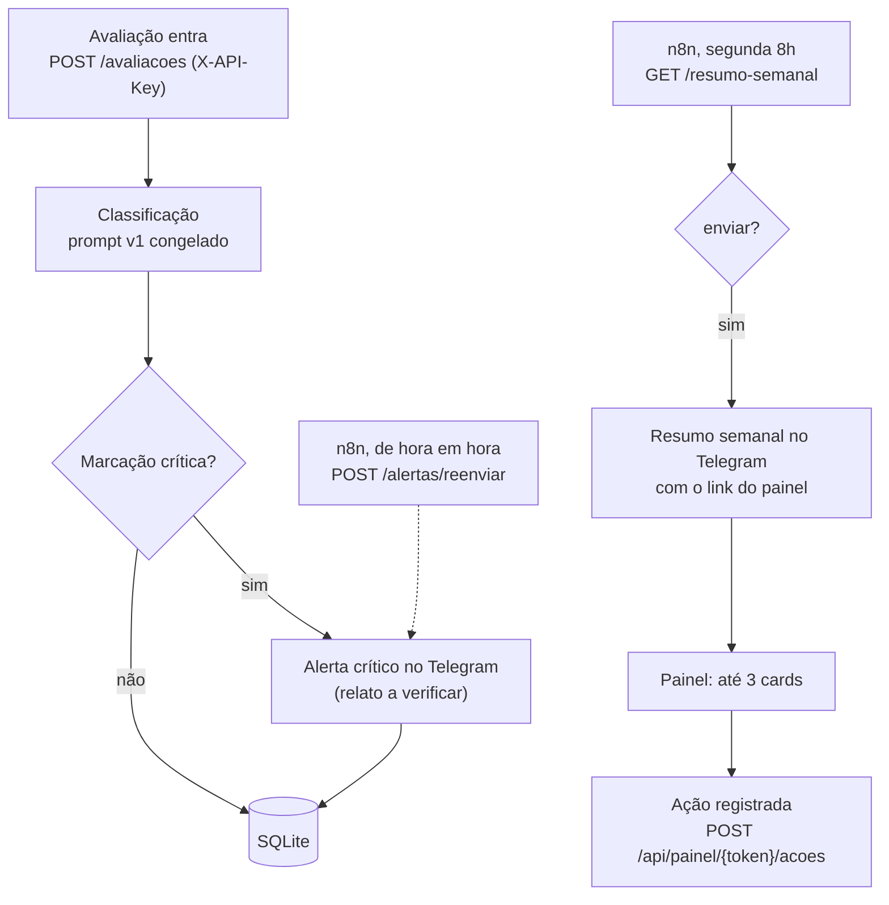

# radar-avaliacoes

O Radar de Avaliações é um assistente para o dono de restaurante que recebe muitas avaliações de clientes e tem pouco tempo para lê-las. Ele classifica cada avaliação, avisa na hora quando há um relato grave a verificar e, uma vez por semana, transforma o que foi dito em até 3 ações. O dono decide cada uma pelo painel, em uma página pensada para o celular.

Dados simulados. Projeto independente, sem vínculo com o iFood.

## Como funciona



O FastAPI é o único dono das regras e dos dados; o n8n só chama rotas e o Telegram só recebe mensagens
([especificação](docs/ESPECIFICACAO.md), seção "Contratos e dados"). Respostas públicas a clientes nunca são enviadas automaticamente.

## O que já roda

| O quê | Onde está |
| --- | --- |
| API FastAPI com SQLite: recebe avaliações, ignora duplicata, exige `X-API-Key` | [`app/main.py`](app/main.py), [`app/banco.py`](app/banco.py), [`tests/test_api_avaliacoes.py`](tests/test_api_avaliacoes.py) |
| Classificador multirrótulo e detecção de criticidade (prompt v1 congelado) | [`app/classificador.py`](app/classificador.py), [`prompts/classificador/v1.md`](prompts/classificador/v1.md) |
| Alerta crítico no Telegram, um por avaliação | [`app/alertas.py`](app/alertas.py), [`app/telegram.py`](app/telegram.py), [`tests/test_alerta_telegram.py`](tests/test_alerta_telegram.py) |
| Recuperação de alertas: reenvio por `POST /alertas/reenviar`, teto de tentativas e reconhecimento manual | [`app/alertas.py`](app/alertas.py), [`scripts/reconhecer_alerta.py`](scripts/reconhecer_alerta.py), [especificação](docs/ESPECIFICACAO.md) |
| Ranking dos 3 principais problemas da semana e resumo semanal (`GET /resumo-semanal`) | [`app/ranking.py`](app/ranking.py), [`config/ranking.json`](config/ranking.json), [`app/resumo.py`](app/resumo.py) |
| Painel mobile-first (`/painel/{token}`): cards, ação, histórico, link com validade de 7 dias | [`app/painel/`](app/painel/), [`app/tokens.py`](app/tokens.py), `tests/test_painel_*.py` |
| Workflows do n8n: resumo semanal e reenvio de alertas, como JSON importáveis | [`n8n/`](n8n/), [`docs/N8N.md`](docs/N8N.md), [`tests/test_n8n_workflows.py`](tests/test_n8n_workflows.py) |
| Simulador de avaliações e semana sintética fixa para o teste de 2 minutos | [`scripts/simulador.py`](scripts/simulador.py), [`scripts/semana_de_teste.py`](scripts/semana_de_teste.py) |

## Medido até agora

Tudo sobre dados simulados. Nenhuma linha abaixo comprova desempenho real.

| O quê | Resultado | Data | Ressalvas |
| --- | --- | --- | --- |
| Alerta crítico: tempo até a confirmação do Telegram | 18 alertas; mediana de 1,8 s, máximo de 6,8 s | 31/10/2026 | Uma rodada, dados simulados. O tempo vai da entrada no endpoint à confirmação do Telegram e inclui a classificação. Sem teste de carga. Medido com [`scripts/medir_alertas.py`](scripts/medir_alertas.py); o resultado dessa rodada não está versionado no repositório. |
| Classificação multirrótulo e criticidade (65 avaliações reservadas, 3 rodadas) | Veja [Resultado da avaliação oficial da v1](#resultado-da-avaliação-oficial-da-v1) | 30/10/2026 | Amostra pequena, rotulador único, dados fictícios criados com apoio de IA. Veja também "O que estes números não dizem" e "Limitações". |
| Teste de 2 minutos | Meta não atingida (226 s) | 01/11/2026 | Veja a seção abaixo. |

## Teste de 2 minutos

Teste feito em 01/11/2026 com 1 testadora, no computador (navegador com janela estreita e mouse), com a semana sintética fixa. Tempo até o 3º card marcado como concluído: 226 s (3 min 46 s). A meta de 120 s não foi atingida. Ela não pediu ajuda. A hesitação observada foi na rolagem do mouse. Ela marcou os 3 cards como concluídos, não preencheu a nota em nenhum, e depois do 3º não soube o que fazer. O tempo por card não foi anotado. Teste exploratório com 1 pessoa, sem validação estatística, feito no computador e não no celular.

A v1 não tem aviso de fim depois do último card. Que isso explique a dúvida da testadora é uma hipótese a testar, não uma conclusão.

O roteiro está em [`docs/TESTE_2_MINUTOS.md`](docs/TESTE_2_MINUTOS.md).

## Como rodar

Ative o ambiente (dependências em `requirements.txt`; `requirements-dev.txt` para os testes):

```powershell
.\.venv\Scripts\Activate.ps1
```

### Servidor

As variáveis ficam no `.env`, que não vai para o Git: `RADAR_API_KEY`, `RADAR_DB`, `RADAR_URL_BASE`, `ANTHROPIC_API_KEY`, `RADAR_TELEGRAM_TOKEN` e `RADAR_TELEGRAM_CHAT_ID`. O uvicorn carrega o arquivo com `--env-file`:

```
uvicorn app.main:app --env-file .env
```

`RADAR_URL_BASE` é o endereço do app (http ou https, sem barra final) e a base do link do painel: o link da mensagem é `RADAR_URL_BASE/painel/<token>`. Ausente ou inválida, o `GET /resumo-semanal` responde 500 e não cria token. Para teste local use `http://127.0.0.1:8000`; **com esse valor, o link só abre no computador onde o app roda.**

A v1 roda com **um processo**: o uvicorn sem `--workers`, que é o padrão. O SQLite aceita um escritor por vez, e a trava que evita o envio duplicado de alerta vale dentro do processo. Com `--workers N`, uma mensagem de alerta pode sair duplicada num restart. É uma limitação conhecida; a alternativa futura é um estado "em envio" no esquema.

`GET /resumo-semanal` (com `X-API-Key`) devolve o resumo da última semana completa, ou da semana de `?semana=AAAA-MM-DD`. Cada chamada com algo a enviar cria um link novo do painel (exceto no aviso curto de volume pequeno, que não leva link).

### Testes

```powershell
pytest -W error::ResourceWarning
```

### n8n

Como subir (`npx n8n`), importar os dois workflows, configurar credenciais e executar manualmente: [`docs/N8N.md`](docs/N8N.md). Com o n8n local, as agendas só disparam com o n8n e o app ligados.

### Teste de 2 minutos

Preparação da semana sintética e roteiro do observador: [`docs/TESTE_2_MINUTOS.md`](docs/TESTE_2_MINUTOS.md).

## O que ainda não existe

- App publicado com HTTPS (hoje roda local).
- Disparo pela agenda do n8n testado: os workflows foram executados manualmente em 01/11/2026, mas ainda não foram ativados ([`docs/N8N.md`](docs/N8N.md), seção 6).
- Teste do painel no celular.
- Medida independente da classificação (a v2 exige um conjunto novo de avaliações).

## Resultado da avaliação oficial da v1

Avaliação do classificador (prompt v1 congelado) sobre as 65 avaliações reservadas para medir (50
gerais e 15 críticas, do conjunto de 85 avaliações fictícias do projeto), em 3 rodadas completas. **Não é prova de desempenho real:** veja as ressalvas abaixo, que valem para
qualquer número desta seção.

- **Quando e o quê:** 2026-10-30, `claude-sonnet-5-5`, no commit da tag
  [`classificador-v1-congelado`](https://github.com/breno-hbs/radar-avaliacoes/tree/classificador-v1-congelado).
  O prompt, o schema, os parâmetros, a regra de retentativa e os dados foram conferidos por hash
  antes da execução ([registro de congelamento](prompts/classificador/v1.congelamento.md)). Foram 195
  chamadas (65 avaliações × 3 rodadas), sem retentativas. A avaliação oficial foi executada uma vez
  (0 execuções abortadas).
- **Como se mediu:** o protocolo foi escrito antes de qualquer número e reporta as três rodadas e a
  média, sem escolher a melhor ([protocolo](docs/AVALIACAO_PROTOCOLO.md)). O relatório completo
  está em [`avaliacao/resultados/v1/relatorio.md`](avaliacao/resultados/v1/relatorio.md).
- **A v1 foi escolhida por fidelidade ao Guia de Rotulação v1.1, não por métrica:** ela empatou com
  a v0 nos 20 exemplos de desenvolvimento.

### 50 avaliações gerais

| | Rodada 1 | Rodada 2 | Rodada 3 | Média |
|---|---|---|---|---|
| F1 micro | 1,000 | 1,000 | 1,000 | 1,000 |
| F1 macro | 1,000 | 1,000 | 1,000 | 1,000 |

F1 por categoria (média das 3 rodadas): `atraso` 1,000; `item_faltando` 1,000;
`qualidade_temperatura` 1,000; `embalagem` 1,000; `atendimento` 1,000; `entregador` 1,000.

Falsos alertas (avaliação não crítica marcada como crítica): **0 de 50 em cada rodada**; saídas
inválidas nas 3 rodadas e nos 65 itens: **0 de 195**.

### 15 avaliações críticas

| | Rodada 1 | Rodada 2 | Rodada 3 | Média |
|---|---|---|---|---|
| Recall geral (detectadas) | 15 de 15 | 15 de 15 | 15 de 15 | 15,00 de 15 |
| `saude` | 5 de 5 | 5 de 5 | 5 de 5 | 5,00 de 5 |
| `alergia` | 5 de 5 | 5 de 5 | 5 de 5 | 5,00 de 5 |
| `cobranca_indevida` | 5 de 5 | 5 de 5 | 5 de 5 | 5,00 de 5 |

Falsos positivos por marcação: 0 em cada tipo e em cada rodada; saídas inválidas nas 3 rodadas e nos
65 itens: 0 de 195. Nenhuma previsão mudou entre as rodadas. Custo estimado da avaliação: cerca de US$ 1,46 (706.527 tokens de
entrada e 4.871 de saída; o custo real está no Console).

**Observação qualitativa (fora da métrica).** Nos críticos, a métrica oficial é só a criticidade; as
categorias operacionais desses 15 casos não entram em nenhuma conta. Em dois casos a criticidade
saiu certa e as categorias diferiram do gabarito, igual nas 3 rodadas:

- `crit-015`: o modelo acrescentou `atendimento` ao gabarito `item_faltando`.
- `crit-014`: o modelo acrescentou `entregador` ao gabarito `atraso`. O gabarito (só `atraso`)
  difere do exemplo do guia v1.1 ("O entregador marcou como entregue, mas não entregou" →
  `entregador` e `atraso`), e a previsão é compatível com esse exemplo. O texto do caso ("deram
  baixa como entregue") não nomeia o entregador, então o gabarito (só `atraso`) também é
  defensável. O `crit-014` não estava entre os 8 casos ambíguos registrados, e não foi
  registrado retroativamente. O gabarito não foi corrigido depois da medição.

### O que estes números não dizem

- Amostra pequena (50 gerais e 15 críticos), rotulador único, sem medida de concordância.
- As 85 avaliações são fictícias e foram criadas com apoio de IA; nenhuma foi escrita à mão. Se uma
  IA parecida gera os dados e classifica, o acerto pode sair inflado. É uma limitação aberta.
- Os 15 casos críticos são uma amostra enriquecida, não representam a frequência real.
- O conjunto crítico não é totalmente independente da definição dos critérios: o `crit-007`
  motivou a regra de acúmulo do guia v1.1 (antes de qualquer execução) e há exposição ao `crit-009`
  (a primeira redação do prompt trazia uma cláusula derivada dele, removida antes de qualquer
  medição oficial). O prompt foi escrito por quem conhecia os rótulos das 85 avaliações (20 de desenvolvimento e 65
  reservadas) e os 8 casos ambíguos registrados em [`docs/CASOS_AMBIGUOS.md`](docs/CASOS_AMBIGUOS.md).
- Os dados (`data/`) e o diário da avaliação (`avaliacao/resultados/v1/diario.jsonl`) publicam o
  texto e o gabarito dos 65 itens reservados. Esses itens ficam expostos e não servem mais para uma
  medida independente: uma v2 precisa de um conjunto novo.
- Estes números não comprovam desempenho com clientes reais.
- "Nunca chegou" é classificado como `atraso`; alergia de terceiro fica por interpretação do modelo.
- Saídas inválidas devem ser citadas na mesma frase dos falsos alertas (aqui: 0 de 50 falsos
  alertas; saídas inválidas nas 3 rodadas e nos 65 itens: 0 de 195).
- Mudar o prompt depois deste resultado cria uma v2, com métricas exploratórias; o resultado da v1
  continua publicado.

## Limitações

- As 85 avaliações são fictícias, criadas com apoio de IA; nenhuma foi escrita à mão. As classificações foram revisadas manualmente por uma única pessoa (rotulador único).
- Como as avaliações foram criadas com apoio de IA, a taxa de acerto pode sair inflada se uma IA parecida fizer a classificação. Essa limitação continua aberta.
- "Entrega que nunca chegou" é classificada como `atraso` na versão 1 do projeto; não há categoria própria para entrega que falhou.
- As 50 avaliações gerais avaliam o protótipo; não garantem desempenho em produção.
- Os 15 casos críticos são uma amostra enriquecida, não representam a frequência real.
- As 85 avaliações demonstram o processo de avaliação do classificador; não comprovam desempenho com clientes reais.
- O caso `crit-007` influenciou uma regra de rotulação: a regra de acúmulo entre `alergia` e `saude`, na versão 1.1 do Guia de Rotulação (2026-10-28).
- A alteração ocorreu antes da execução do classificador e não foi motivada por previsões do modelo.
- Mesmo assim, o conjunto crítico não ficou totalmente independente da definição dos critérios.
- Uma avaliação futura mais rigorosa exigirá novos exemplos independentes, preparados após o congelamento das regras.
- O prompt foi escrito por quem conhecia os rótulos das 85 avaliações (20 de desenvolvimento e 65 reservadas) e os 8 casos ambíguos de [`docs/CASOS_AMBIGUOS.md`](docs/CASOS_AMBIGUOS.md) (2 gerais e 6 críticos). Houve exposição ao `crit-009`: a primeira redação trazia uma cláusula derivada dele, removida antes de qualquer medição oficial.
- Alergia de terceiro (pedido consumido por outra pessoa que é alérgica) fica por interpretação do modelo: o prompt não tem cláusula sobre isso.
- Os dados (`data/`) e o diário da avaliação (`avaliacao/resultados/v1/diario.jsonl`) publicam o texto e o gabarito dos 65 itens reservados: eles ficam expostos e não servem mais para uma medida independente. Uma v2 precisa de um conjunto novo.
